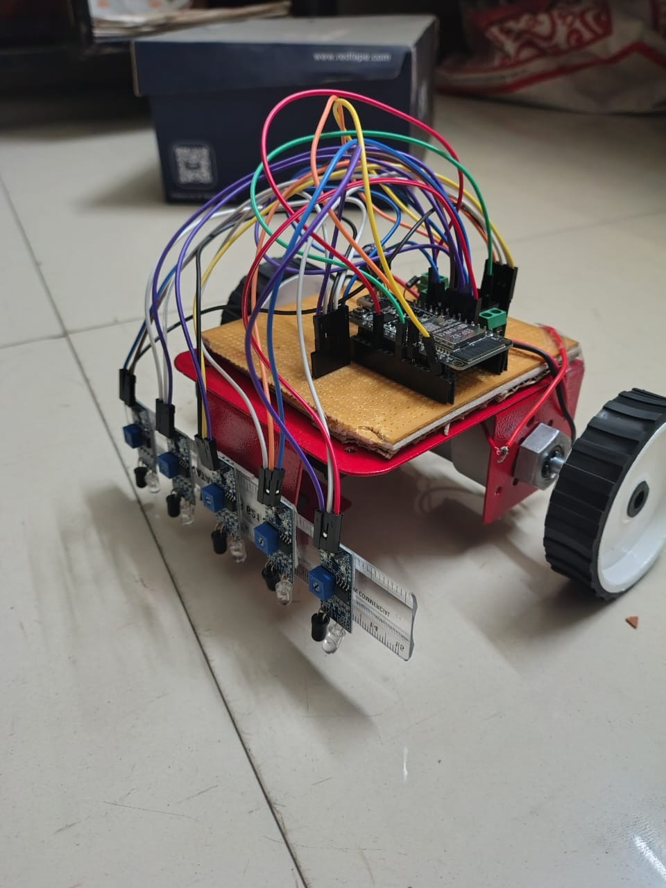

# ESP32 Line-Following Robot — Industrial Material Transport

**Mechatronics Case Study Project | SVNIT Surat | 2026**



## 1. Project Overview

This project explores a low-cost approach to automated material transportation through the development of a line-following mobile robot.

Developed as part of a Mechatronics Case Study Project at **Sardar Vallabhbhai National Institute of Technology (SVNIT), Surat**, this prototype demonstrates the integration of mechanical systems, infrared sensing, embedded control and motor actuation.

The concept is inspired by Automated Guided Vehicles (AGVs), which are used in industrial environments to transport materials along predefined routes.

Our objective was to develop a functional educational prototype using readily available electronic and mechanical components.

## 2. Industrial Problem

Material transportation between workstations often involves repetitive manual movement.

This consumes time and labour, while commercially available AGV solutions may be expensive for smaller workshops.

Our prototype explores a simpler approach using a predefined floor marking to guide autonomous movement.

## 3. Hardware Components

| Component | Function |
|---|---|
| ESP32 development board | Main controller |
| IR sensor strip | Tracking-line detection |
| L293D motor driver | DC motor control |
| 2 DC motors | Robot locomotion |
| 2 wheels | Differential drive |
| Chassis | Mechanical support |
| 3 rechargeable LiPo cells | Power supply |
| General circuit board (GCB) | Electronic mounting |
| Jumper wires and headers | Electrical connections |
| Switch | Power control |

## 4. System Architecture

The prototype uses a two-wheel differential-drive configuration.

The infrared sensor strip detects the black tracking line. Its signals are processed by the ESP32, which determines the required directional correction.

The ESP32 communicates with the L293D motor driver, which controls the two DC motors.

By varying the relative wheel speeds, the robot adjusts its direction and follows the predefined path.

### System Block Diagram

```text
       IR SENSOR STRIP
        (Line Detection)
               |
               v
             ESP32
        (Control Logic)
               |
               v
         L293D DRIVER
               |
          +----+----+
          |         |
          v         v
       LEFT       RIGHT
       MOTOR      MOTOR
          |         |
          v         v
       LEFT       RIGHT
       WHEEL      WHEEL

       POWER SUPPLY
       3 LiPo Cells
```

## 5. Control Logic

| Sensor condition | Robot response |
|---|---|
| Line detected in the middle | Moves straight |
| Line detected on the left | Slows left wheel and turns left |
| Line detected on the right | Slows right wheel and turns right |
| Line not detected | Stops |
| All sensors detect the marked condition | Stops at junction/end |

## 6. Development Process

1. Fixed the two motors and wheels to the chassis.
2. Mounted the electronics on the platform.
3. Soldered headers onto the general circuit board.
4. Integrated the ESP32, L293D motor driver and IR sensor strip.
5. Connected the rechargeable battery system through a power switch.
6. Connected the sensor outputs to the controller.
7. Tested the robot on a black-tape tracking path.

## 7. Mechanical and Electronic Integration

The prototype combines:

- Two-wheel mechanical drive platform.
- Front-mounted infrared sensing arrangement.
- ESP32-based embedded controller.
- L293D motor driver.
- Battery-powered electrical system.
- General circuit board with soldered headers and jumper connections.

## 8. Limitations Identified

- Requires a clearly distinguishable dark line on a lighter surface.
- Loose jumper-wire connections can affect reliability.
- Does not currently include obstacle detection.
- Has limited payload capacity.
- The basic control approach can be improved.

## 9. Future Improvements

- Implement PID control for smoother and more accurate tracking.
- Integrate obstacle-detection sensors.
- Improve wiring reliability and electronic packaging.
- Upgrade the motors and drivetrain for higher payload capacity.
- Evaluate tracking accuracy and response under different conditions.

## 10. Learning Outcomes

This project provided practical exposure to:

- Mechatronics system integration.
- ESP32-based embedded systems.
- Infrared sensor interfacing.
- DC motor control.
- Differential-drive robotics.
- Circuit connections and soldering.
- Mechanical assembly and prototyping.
- Testing and troubleshooting.

## 11. Team and Acknowledgements

**Project team:**
- Shivam Mistry
- Param Baraiya
- Tanay Rai

**Institution:** Department of Mechanical Engineering, Sardar Vallabhbhai National Institute of Technology (SVNIT), Surat.

**Project Supervisor:** Dr. Raju Prasad Mahto, Assistant Professor.

## 12. Repository Contents

Project photographs, circuit documentation, source code and demonstration media will be progressively added to this repository.

---

*This is an educational mechatronics prototype demonstrating the fundamental principles of fixed-route robotic navigation. It is not a production-ready industrial AGV.*
